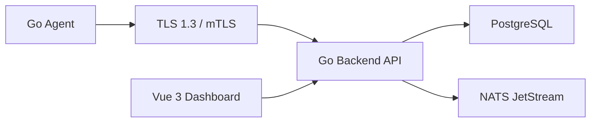

# DevOps Sentinel

An open-source DevOps monitoring and AI-powered troubleshooting platform for individual developers and small teams. The planned system uses a lightweight Go agent to collect host metrics and logs, redact secrets on the machine that produced them, and deliver the result to a central API over TLS 1.3 with mutual authentication.

[](LICENSE)
[](#project-status)
[](https://go.dev/)
[](https://vuejs.org/)
[](https://www.postgresql.org/)
[](https://docs.nats.io/nats-concepts/jetstream)
[](https://github.com/qiuzhonggu/devops-sentinel/actions/workflows/ci.yml)

**Project status: Planning / Initial Development.**

There is no release, agent binary, backend service, or dashboard yet. The repository holds the project definition, the target architecture, the security model, the roadmap, and the contributor workflow. Every product feature below is **Planned** until code, tests, and this document say otherwise.

## Contents

- [Project Overview](#project-overview)
- [Project Motivation](#project-motivation)
- [Core Features](#core-features)
- [System Architecture](#system-architecture)
- [Technology Stack](#technology-stack)
- [Security Design](#security-design)
- [Fault Tolerance](#fault-tolerance)
- [Development Roadmap](#development-roadmap)
- [Repository Layout](#repository-layout)
- [Development with Devin Bot](#development-with-devin-bot)
- [Contributing](#contributing)
- [License](#license)
- [Project Status](#project-status)

## Project Overview

People who run a handful of Linux VPS instances, Docker hosts, or small homelab servers still need to know when a disk fills, a process leaks memory, or a service starts failing. A full observability stack can do that, and it can also become another system to operate.

DevOps Sentinel is aimed at that gap. It is a single-purpose monitoring and troubleshooting platform for one operator or a small team:

- A Go agent on each host collects local signals and keeps a bounded copy when the network is down.
- The agent removes API keys, tokens, passwords, and similar secrets before data leaves the host.
- A Go API stores what it accepts, isolates one account's data from another's, and is the only path to the database.
- A Vue 3 dashboard, planned for a later phase, is where operators inspect hosts, search logs, and receive alerts.
- AI-assisted diagnosis is a later phase. It will run on redacted data, after collection and search already work.

The project is a monitoring tool with an explicit security boundary. It is not a general log archive, a multi-tenant SaaS product, or a replacement for Prometheus, Grafana, and Loki in a large organization.

## Project Motivation

A small fleet is large enough to hide a failure and small enough that nobody wants to staff an observability platform.

Typical day-to-day friction:

- Metrics live in one place, `journalctl` output lives on the host, and container logs live somewhere else. An incident means opening several SSH sessions.
- File logs rotate, and a host that was offline during the incident no longer has the lines that mattered.
- A pasted log often contains a bearer token, a database URL, or a cloud key. The copy used for debugging becomes the leak.
- Retry loops in homemade collectors fill a disk, or they reconnect together and overwhelm a small API.
- Alerting, when it exists, is a cron script that only one person understands.

Hosted observability products solve much of this and ask a small team to pay per host, trust a third party with raw logs, and learn a product they only partly need. Self-hosted stacks have the opposite cost: more moving parts than the fleet they watch.

DevOps Sentinel exists so that one person can put a small agent on each server, keep secrets off the wire, and later ask one question from a single UI: what changed on this host before the failure?

## Core Features

The table is the scope list. **Planned** means the feature is accepted direction and is not implemented in this repository.

| Feature | Phase | Status |
| --- | --- | --- |
| Lightweight Go agent | 1 | Planned |
| CPU, memory, disk, and network monitoring | 1 | Planned |
| Linux journald and file log collection | 1 | Planned |
| Incremental collection and resume from a saved offset | 1 | Planned |
| Bounded local cache and delivery after a network outage | 1 | Planned |
| TLS 1.3 and mutual TLS | 1 | Planned |
| Independent identity for each agent | 1 | Planned |
| Redaction of API keys, tokens, passwords, and private keys | 1 | Planned |
| Backend ingest API | 1 | Planned |
| Centralized log storage | 1 | Planned |
| Docker container monitoring | 2 | Planned |
| Web dashboard and multi-server management | 2 | Planned |
| Log search | 2 | Planned |
| Anomaly alerts | 2 | Planned |
| Centralized log management in the dashboard | 2 | Planned |
| AI-assisted fault diagnosis | 3 | Planned |
| Anomaly detection and root-cause analysis | 3 | Planned |
| Automated operations | 3 | Planned |

Docker monitoring is opt-in when it is built. Access to the Docker socket is equivalent to root on the host, so it will not be a default collector.

AI diagnosis and automated remediation wait until Phase 1 collection and Phase 2 search are real. The project will not send unredacted logs to a model.

## System Architecture

The diagram is the target architecture. It is not a running deployment.



| Component | Responsibility |
| --- | --- |
| Go Agent | Collect, redact, spool, and ship. One identity per host. |
| TLS 1.3 / mTLS | Encrypt the connection and authenticate both the API and the agent. |
| Go Backend API | Authorize the agent, redact again, persist data, and serve the dashboard. |
| PostgreSQL | System of record for accounts, agents, inventory, alerts, and indexed logs. |
| NATS JetStream | Durable bus for asynchronous consumers such as alert evaluation. |
| Vue 3 Dashboard | Operator UI. It talks only to the API. |

Ingest flows from the agent, through mutual TLS, into the API. The API writes PostgreSQL and, once the bus exists, publishes work to JetStream. The dashboard reads and changes state only through the API. Browsers do not receive database credentials or agent certificates.

Phase 1 can persist ingest directly to PostgreSQL. JetStream is part of the target design and is scheduled when a second consumer, starting with alerts in Phase 2, needs a durable stream. That sequencing is recorded in the [roadmap](docs/ROADMAP.md).

A longer description of trust boundaries and component ownership is in [docs/ARCHITECTURE.md](docs/ARCHITECTURE.md).

## Technology Stack

| Area | Choice |
| --- | --- |
| Agent | Go |
| Backend | Go |
| Frontend | Vue 3 and TypeScript |
| Database | PostgreSQL |
| Message queue | NATS JetStream |
| Communication | HTTPS, TLS 1.3, and mutual TLS |
| Deployment | Docker Compose |
| CI/CD | GitHub Actions |

Go is the implementation language for anything that runs on a server or beside a server. The agent must be a single static binary with a small runtime footprint. The API uses the same language so the ingest protocol, redaction rules, and identity checks can be reviewed in one place.

Vue 3 and TypeScript are reserved for the dashboard. PostgreSQL holds state that must survive a process restart. NATS JetStream carries work that can be retried without holding an HTTP request open. Docker Compose is the intended local and single-node deployment. GitHub Actions is the CI system; the workflow in this repository currently checks required documents only.

None of these components are wired together yet.

## Security Design

Security is part of the first implementation, not a later hardening pass. The controls below are design requirements. They are **Planned** until tests exercise them. Details and the threat list live in [docs/SECURITY.md](docs/SECURITY.md).

### Least privilege

The agent will run as a dedicated unprivileged user. It will read only the log paths an operator configures. It will not execute shell commands found in log lines. Database passwords, the NATS credential, and dashboard sessions stay on the control plane. The Docker socket, if used at all, is an explicit opt-in because socket access can control the host.

### Mutual TLS identity

Each agent will have its own client certificate issued by a project CA. The agent will authenticate the API certificate, and the API will authenticate the agent certificate. TLS 1.3 is the minimum protocol. An accepted certificate maps to one agent record inside one account. A shared API token is not the agent identity.

### Certificate rotation and revocation

Client certificates will be short-lived, with an overlap window so a host can keep shipping while a new certificate is installed. Expiry is not the only control. The API will also check a revocation list, so a stolen certificate can be rejected before it expires. Revoking one agent does not require reissuing certificates for the rest of the fleet.

### Redaction on the agent, then again on the server

The agent will mask secrets before data is spooled or transmitted. The patterns cover API keys, bearer tokens, passwords in assignments and URLs, private-key blocks, and connection strings that embed credentials. The server will apply the same classes of rules again. Agent redaction is a convenience and a leak reduction. Server redaction is the control that still runs when an agent is old, buggy, or modified.

Redaction is lossy on purpose. The platform will not keep a reversible copy of a matched secret.

### Bounded local cache

The spool on disk will have a hard quota. When the quota is reached, the agent will stop accepting new data and report the overflow. It will not grow without a limit, and it will not silently delete security-relevant logs to make room. Metrics may be downsampled before logs are dropped. The quota will be visible to the operator.

### Stop unbounded retries and resource exhaustion

Retries will use exponential backoff, random jitter, a retry cap, and a circuit breaker. Catch-up after an outage will be rate limited. The agent will also have budgets for CPU, memory, disk, and open files, and it will shed load inside those budgets. A monitoring agent that consumes the host is a failed agent.

### User data isolation

Every stored record will carry the account that owns it. Agent credentials will be issued inside one account and will not be valid in another. API queries will filter by that account on every request. Background jobs will carry the same identifier. There is no cross-account browser or admin view in the current design.

Report vulnerabilities in private. See [SECURITY.md](SECURITY.md).

## Fault Tolerance

The agent will run on networks that fail and on hosts that are short of disk. The control plane is allowed to be down. The host is not a place to buffer forever. These mechanisms are **Planned**.

| Mechanism | Intended behavior |
| --- | --- |
| Exponential backoff | Wait longer after each consecutive transport failure, up to a fixed cap. |
| Random jitter | Spread retries so a fleet does not reconnect in one burst. |
| Bounded queue | Cap the in-memory queue and the on-disk spool. A full buffer is a reported condition. |
| Circuit breaker | After repeated failures, stop calling the API and allow a single probe through on a timer. |
| Rate-limited catch-up | Drain a backlog at a limited rate after the circuit closes. |
| Resource budget | Refuse new work when CPU, memory, disk, or file-descriptor use crosses the agent's own budget. |

Backoff without a cap becomes a tight loop. A queue without a bound becomes a disk failure. A circuit breaker without a probe never recovers. Catch-up without a rate limit turns a restored API into an outage. The implementation will treat these as one policy, covered by tests, rather than as independent tunables left at infinite defaults.

Design targets, such as spool size and the backoff cap, will be written down when the agent code exists. Numbers in a planning document are not runtime configuration.

## Development Roadmap

The roadmap is the order of implementation. A phase is done only when its exit criteria in [docs/ROADMAP.md](docs/ROADMAP.md) are met and the feature table above is updated in the same change.

### Phase 1 — Agent, collection, transport, and ingest

Build the Go agent, host resource collection, journald and file collection, secure communication, redaction, the bounded spool, and the backend API that accepts what the agent sends.

Exit signal: an integration test collects from a Linux host, redacts a fixture secret, survives a restart and a disconnected API, and inserts the accepted payload through the real ingest API.

### Phase 2 — Dashboard, fleet view, search, and alerts

Build the Vue 3 console, multi-server management, log search, Docker container monitoring, and real-time alerts. Introduce NATS JetStream for asynchronous alert evaluation.

Exit signal: an operator can sign in, see more than one server, search a known log line, and receive an alert fired from a recorded condition.

### Phase 3 — AI diagnosis and assisted remediation

Add AI log analysis, anomaly detection, root-cause analysis, and guided or automated remediation on top of redacted data.

Exit signal: a diagnosis cites the stored signals it used, the prompt path cannot see unredacted secrets, and any automated action is opt-in, scoped, and audited.

Work that shows up before its phase needs a roadmap change in the same pull request.

## Repository Layout

```text
devops-sentinel/
├── README.md
├── LICENSE
├── CONTRIBUTING.md
├── SECURITY.md
├── .gitignore
├── .github/
│   ├── ISSUE_TEMPLATE/
│   ├── PULL_REQUEST_TEMPLATE.md
│   └── workflows/
│       └── ci.yml
├── docs/
│   ├── ARCHITECTURE.md
│   ├── SECURITY.md
│   └── ROADMAP.md
├── agent/
│   └── README.md
├── backend/
│   └── README.md
├── frontend/
│   └── README.md
├── deploy/
│   └── README.md
└── scripts/
    ├── README.md
    └── check-docs.sh
```

`agent/`, `backend/`, `frontend/`, and `deploy/` contain a short README that records the intended layout. They do not contain application code yet. Empty product directories would imply a build that does not exist.

## Development with Devin Bot

[Devin](https://devin.ai/) can be used as an AI software engineer on this repository after a maintainer connects the GitHub account. That connection is not configured in the tree. Devin is a contributor that opens pull requests. It is not a reviewer, and it does not merge its own work.

Use one session for one issue.

1. **Split the work.** Turn a single roadmap item into a GitHub issue. State the goal, the non-goals, the files that may change, and the acceptance criteria from [docs/ROADMAP.md](docs/ROADMAP.md).
2. **Point Devin at the issue.** Ask it to read the architecture and security documents before editing. Tell it to implement that issue only.
3. **Require a draft pull request.** Devin works on a branch and opens a draft PR. It does not push to `main`.
4. **Let CI run.** GitHub Actions must finish. Today's workflow checks the required documents. Later workflows will build and test the phase that introduced them. Add those checks in the same change that adds the code.
5. **Review the diff.** A person reviews every pull request. Changes to authentication, TLS, redaction, retention, or tenant isolation need a maintainer review even when the patch looks mechanical.
6. **Close the loop on bugs.** File a bug against the merged behavior, then give Devin that issue. The fix is another pull request, with a regression test once a test harness exists.

Copy this into a Devin session and replace the issue number:

```text
You are working in https://github.com/qiuzhonggu/devops-sentinel on issue #<number>.

Read README.md, docs/ARCHITECTURE.md, docs/SECURITY.md, and docs/ROADMAP.md first.

Implement only that issue.
- Keep the change inside the files the issue names.
- Do not mark a feature as implemented unless this pull request contains the code and the tests.
- Do not add secrets, private keys, certificates, or real logs.
- Follow the redaction, identity, and resource-budget rules in docs/SECURITY.md.
- Open a draft pull request. Do not merge it.
```

A session that rewrites the roadmap, broadens a Phase 1 issue into the dashboard, or claims an AI diagnosis feature is finished should be closed without merge.

## Contributing

Contributions are welcome. Please read [CONTRIBUTING.md](CONTRIBUTING.md) before opening a pull request.

1. Search [open issues](https://github.com/qiuzhonggu/devops-sentinel/issues).
2. Open an [issue](https://github.com/qiuzhonggu/devops-sentinel/issues/new/choose) for a bug in existing material, or for a proposed change. Security reports go through [private advisories](https://github.com/qiuzhonggu/devops-sentinel/security/advisories/new).
3. Wait for a maintainer to confirm large changes. Documentation typos and small factual corrections can go straight to a pull request.
4. Fork the repository and branch from `main`.
5. Open a pull request using the template. Link the issue, describe the test plan, and wait for review.

The [pull request template](.github/PULL_REQUEST_TEMPLATE.md) asks contributors to keep unfinished features marked **Planned**. That rule is intentional.

There is nothing to build yet. A documentation change needs a text editor and `bash scripts/check-docs.sh`. Go and Node toolchains will be documented when the first code lands.

## License

Copyright 2026 qiuzhonggu

Licensed under the Apache License, Version 2.0. See [LICENSE](LICENSE).

You may use, modify, and distribute this project under those terms. It is distributed on an "AS IS" basis, without warranties or conditions of any kind, as stated in the license.

## Project Status

**Planning / Initial Development.**

| Area | State |
| --- | --- |
| Project definition, architecture, security design, and roadmap | Written in this repository |
| Issue and pull request templates | Present |
| Document check in GitHub Actions | Present |
| Go agent | Not started |
| Backend API | Not started |
| PostgreSQL schema | Not started |
| NATS JetStream integration | Not started |
| Vue 3 dashboard | Not started |
| Docker Compose deployment | Not started |
| AI diagnosis | Not started |
| Published release | None |

Do not deploy this repository as a monitoring system. The next implementation target is Phase 1.
