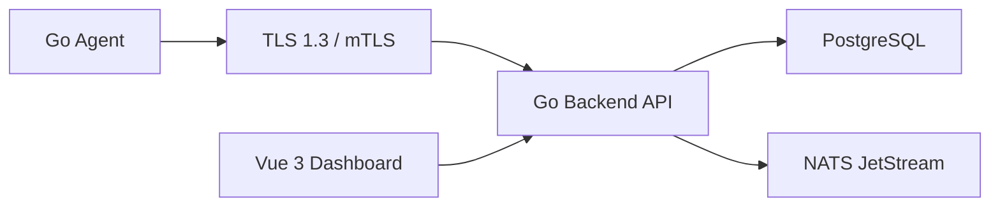

# Architecture

Status: **target design**. The components in this document are not implemented. The diagram matches the one in the [README](../README.md).

## Purpose

DevOps Sentinel collects operational signals from Linux hosts that a person or a small team already runs. The agent is the only software that needs to be installed on those hosts. Everything an operator sees goes through one API.

The design has three constraints:

1. A host must remain usable when the control plane is unreachable.
2. Secrets that appear in logs should be removed before they leave the host, and removed again if they still arrive.
3. One account must never read another account's agents, logs, or alerts.

## Target diagram



## Trust boundaries

| Boundary | What crosses it | What does not |
| --- | --- | --- |
| Host to API | Redacted metrics and logs, agent identity | Database credentials, other tenants' data, a browser session |
| Browser to API | Operator credentials and queries | Direct SQL, NATS, or agent private keys |
| API to PostgreSQL | Authorized records for one account | Raw unmatched secrets, once redaction is in place |
| API to JetStream | Work items already accepted and redacted | Agent private keys and dashboard passwords |

The API is the policy enforcement point. The dashboard is a client. PostgreSQL and NATS are not exposed outside the control-plane network.

## Components

### Go Agent

A single static binary, planned name `sentinel-agent`.

- Sample CPU, memory, disk, and network counters.
- Read journald and configured files from a stored offset.
- Redact secrets before the event is written to the local spool.
- Keep a bounded spool and ship it when the API is reachable.
- Present a client certificate and verify the API certificate.
- Stay inside a CPU, memory, disk, and file-descriptor budget.

The agent does not open a shell to interpret log content. It does not accept remote shell commands. Docker inspection, when it exists, is a separate opt-in collector because the Docker socket grants control of the host.

Intended package layout, not yet created:

```text
agent/
├── cmd/sentinel-agent/
├── internal/collect/
├── internal/docker/
├── internal/redact/
├── internal/buffer/
├── internal/transport/
└── internal/identity/
```

Future module path: `github.com/qiuzhonggu/devops-sentinel/agent`.

### Go Backend API

The API authenticates agents, applies server-side redaction, stores accepted data, and serves the dashboard.

- Agent calls are authorized by the client certificate mapped to one agent in one account.
- Operator calls are authorized by a separate user session. A user session cannot impersonate an arbitrary agent.
- Every query includes the account identifier.
- Ingest that fails redaction or authentication is rejected and counted. It is not written to the system of record.

Future module path: `github.com/qiuzhonggu/devops-sentinel/backend`.

Draft routes, for later design discussion. None of these routes exist:

| Method and path | Caller | Role |
| --- | --- | --- |
| `POST /api/v1/ingest/metrics` | Agent | Accept a batch of host metrics |
| `POST /api/v1/ingest/logs` | Agent | Accept a batch of redacted log events |
| `GET /api/v1/agents` | Operator | List agents in the caller's account |
| `GET /api/v1/logs` | Operator | Search logs in the caller's account |

Paths and payloads can change before implementation. A pull request that adds a route should update this table in the same change.

### PostgreSQL

PostgreSQL is the system of record:

- accounts and users
- agent inventory and certificate state
- metric samples and log events that the API accepted
- alert definitions and alert history
- audit events for revocation, configuration changes, and future remediation actions

Retention limits will be explicit. The database is not an unbounded paste bin.

### NATS JetStream

JetStream is the durable bus for work that should outlive an HTTP request. The first planned consumer is alert evaluation in Phase 2. Phase 1 may ship without the bus and write straight to PostgreSQL. The API remains the only publisher that agents can reach. Agents do not get NATS credentials.

### Vue 3 Dashboard

A TypeScript application, planned for Phase 2. It renders fleet state, log search, and alerts by calling the API. It stores no long-term copy of logs in the browser beyond the current view.

## Data classes

| Class | Examples | Handling |
| --- | --- | --- |
| Measurements | CPU, memory, disk, network counters | Store after authentication |
| Operational logs | journald lines, application files | Redact, then store |
| Secrets | API keys, tokens, passwords, private keys | Replace on the agent and again on the server. Do not store a reversible copy |
| Identity | client certificates, user sessions | Private keys stay on the owner. The server stores public certificate state and revocation |

## Failure behavior

When the API cannot be reached, the agent keeps collecting until the spool quota is full, then pauses intake and surfaces the condition. It does not drop the oldest security log to accept a new line. When the API returns, the agent drains the spool at a limited rate.

When the API rejects an agent certificate, the agent stops sending. It does not fall back to an unsigned connection or a shared bearer token.

## Out of scope

- Windows and macOS agents in the first three phases. Linux is the first target.
- A multi-region control plane.
- Replacing an existing Prometheus or Loki deployment in a large organization.
- Storing unredacted secrets so they can be revealed later.
- Remote command execution from log content or from an AI response.

## Sequencing

The diagram is the destination. The build order is in [ROADMAP.md](ROADMAP.md). Phase 1 is the agent, host collection, mutual TLS, redaction, the local spool, and an API that writes PostgreSQL. The dashboard, Docker collector, JetStream consumers, and AI features come later.
